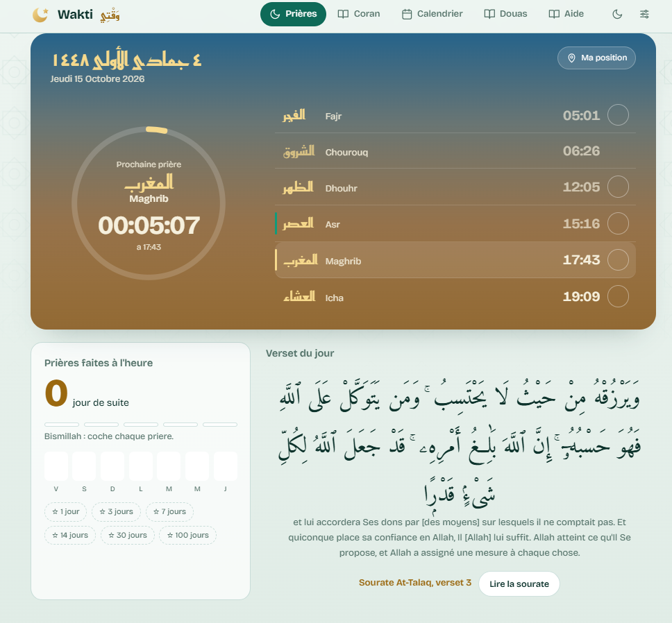
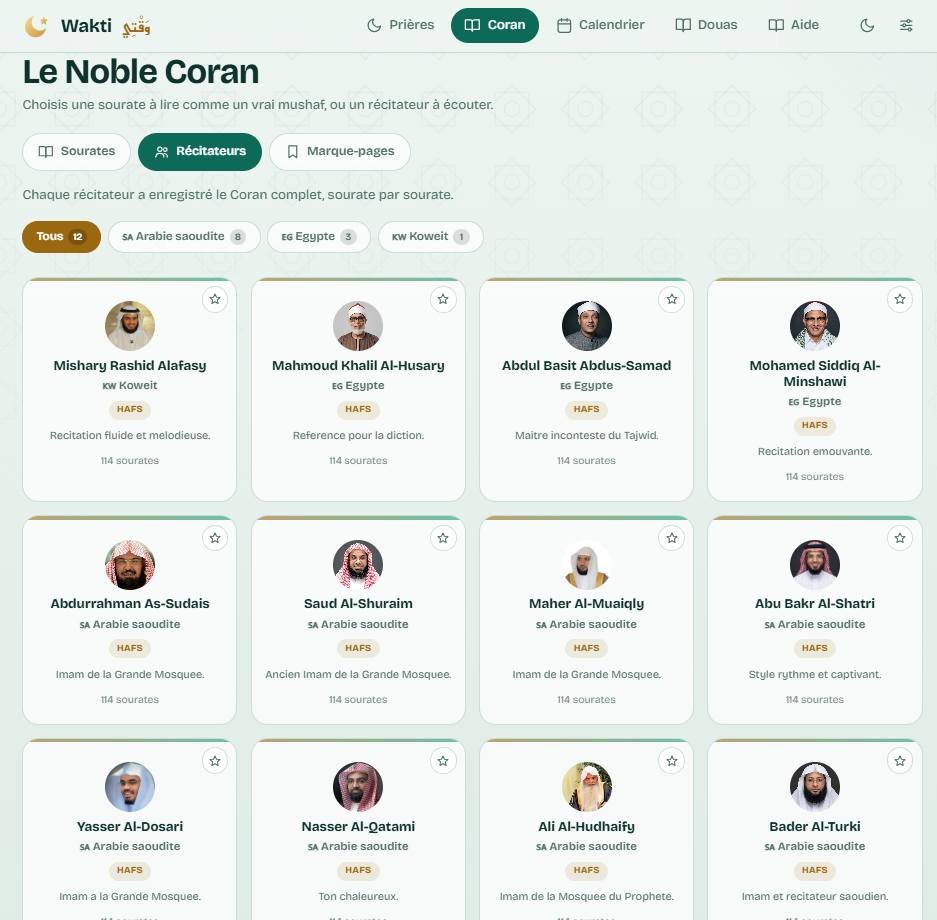
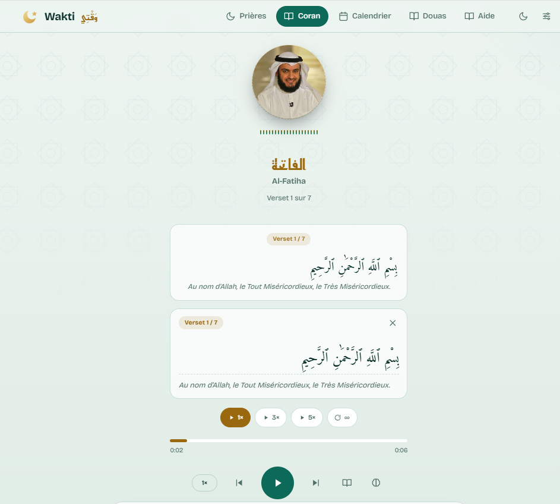
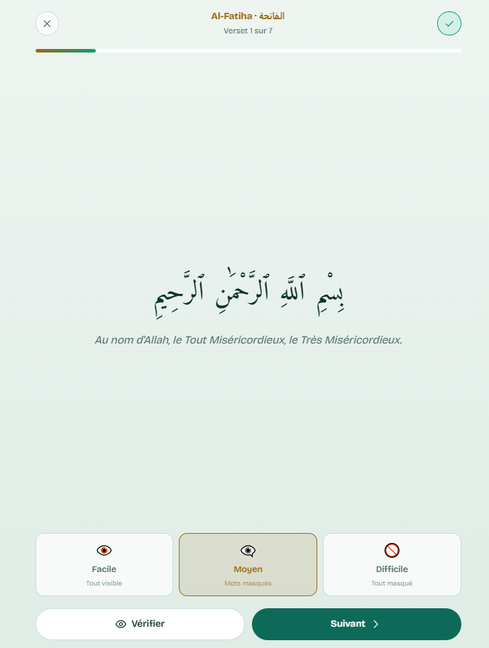
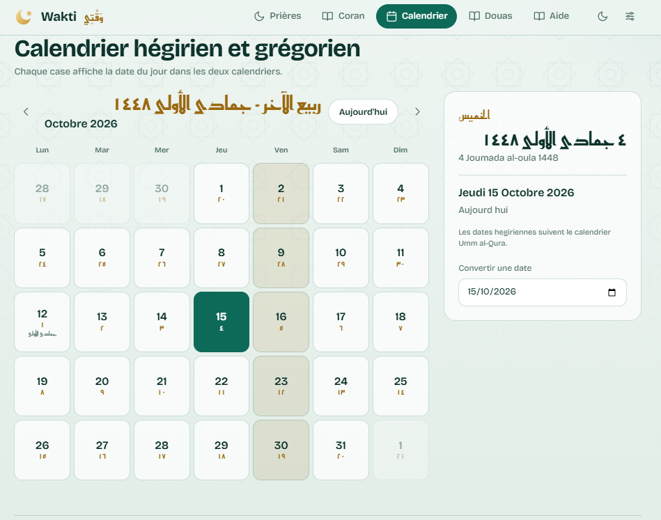
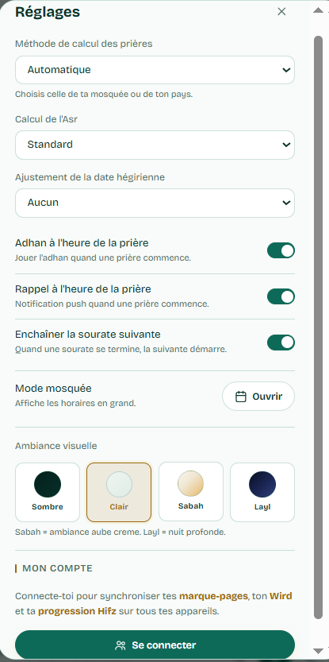
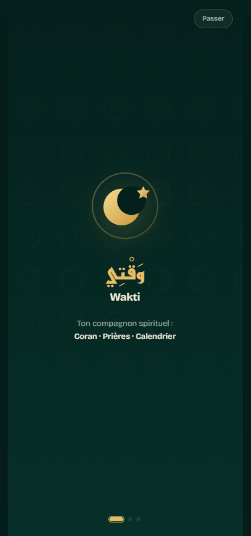
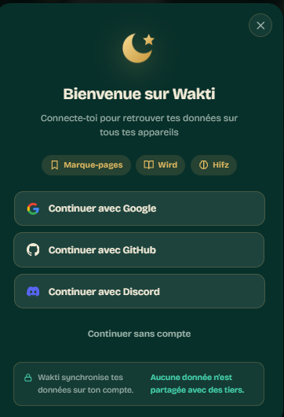

# Wakti — Coran, horaires de prière et calendrier hégirien

**Wakti (وقتي)** est une application web progressive (PWA) qui réunit la lecture et l’écoute du Coran, les horaires de prière et la consultation du calendrier hégirien dans une interface adaptée aux mobiles et aux ordinateurs.

<p align="center">
  <a href="https://wakti-ashen.vercel.app/"></a>
  ·
  <a href="https://github.com/WissemAttouf/Wakti"></a>
</p>

## Présentation

Wakti rassemble plusieurs outils du quotidien dans une interface web responsive : consultation du Coran, écoute de récitations, horaires de prière et calendrier hégirien. Le projet intègre également des fonctionnalités PWA, la sauvegarde locale de préférences et la mise en cache de ressources.

## Fonctionnalités principales

- **Coran :** parcourir les sourates et consulter le texte.
- **Écoute :** lancer des récitations et utiliser les commandes de lecture disponibles.
- **Horaires de prière :** consulter les horaires selon le lieu et les paramètres proposés.
- **Calendrier hégirien :** naviguer entre les dates grégoriennes et hégiriennes.
- **Personnalisation :** utiliser les options d’apparence et gérer les préférences.
- **Expérience PWA :** installer l’application sur un appareil compatible et profiter de la mise en cache des ressources.

## Captures d’écran

Les captures ci-dessous donnent un aperçu de l’interface et des principaux écrans de Wakti. Chaque légende aide à comprendre ce que présente l’image.

## Technologies

| Domaine | Technologies |
|---|---|
| Interface | HTML5, CSS3, JavaScript moderne |
| Application progressive | Web App Manifest, Service Worker, Cache API |
| Déploiement | Vercel |
| Outils | Node.js 20+, npm |
| Données du Coran et des prières | AlQuran Cloud, Aladhan, Islamic Network CDN |
| Audio | Fournisseurs de récitations et endpoint proxy audio |
| Packages serveur optionnels | web-push, @upstash/redis, @vercel/kv |

L’application repose principalement sur des technologies web natives et des modules JavaScript. La disponibilité des données et de l’audio dépend des services externes intégrés.

## Architecture du projet

- `index.html` — structure principale et métadonnées.
- `css/style.css` — styles, thèmes et adaptation responsive.
- `js/app.js` — navigation, Coran, horaires, calendrier et préférences.
- `sw.js` — stratégies de mise en cache.
- `manifest.webmanifest` — métadonnées d’installation et icônes.
- `vercel.json` — paramètres de déploiement et en-têtes.
- `package.json` — métadonnées et scripts.
- `api/` — endpoints serveur utilisés par l’application.

## Installation locale

### Prérequis
- Node.js 20 ou plus récent
- npm
- Git

### Étapes

```bash
git clone https://github.com/WissemAttouf/Wakti.git
cd Wakti
npm install
```

Consultez `package.json` pour les scripts disponibles et les variables d’environnement requises. Certaines fonctionnalités reposant sur des services externes peuvent nécessiter une configuration complémentaire.

## Démonstration

- **Application en ligne :** [wakti-ashen.vercel.app](https://wakti-ashen.vercel.app/)
- **Dépôt GitHub :** [WissemAttouf/Wakti](https://github.com/WissemAttouf/Wakti)

## Auteur

**Wissem Attouf** — Software Engineer | Full-Stack Developer  
[GitHub](https://github.com/WissemAttouf) · [LinkedIn](https://www.linkedin.com/in/wissem-attouf-452509226/) · [Portfolio](https://wissem-portfolio.vercel.app/) · [E-mail](mailto:wattouf35@gmail.com)

---

## 📸 Captures d’écran

<p align="center">
  
  <br><strong>Vue générale de Wakti</strong>
  <br><em>Aperçu de l’interface et de l’organisation visuelle de l’application.</em>
</p>

<p align="center">
  
  <br><strong>Navigation dans l’application</strong>
  <br><em>Vue complémentaire de la navigation et des espaces de l’application.</em>
</p>

<p align="center">
  
  <br><strong>Consultation des contenus</strong>
  <br><em>Aperçu d’un écran de consultation des contenus proposés.</em>
</p>

<p align="center">
  
  <br><strong>Fonctionnalités de Wakti</strong>
  <br><em>Vue complémentaire de l’expérience utilisateur.</em>
</p>

<p align="center">
  
  <br><strong>Expérience utilisateur</strong>
  <br><em>Aperçu supplémentaire de l’interface et de sa lisibilité.</em>
</p>

<p align="center">
  
  <br><strong>Aperçu complémentaire</strong>
  <br><em>Vue additionnelle de l’application.</em>
</p>

<p align="center">
  
  <br><strong>Écran de bienvenue</strong>
  <br><em>Première étape de découverte de Wakti.</em>
</p>

<p align="center">
  
  <br><strong>Authentification</strong>
  <br><em>Écran consacré au parcours d’accès utilisateur.</em>
</p>
